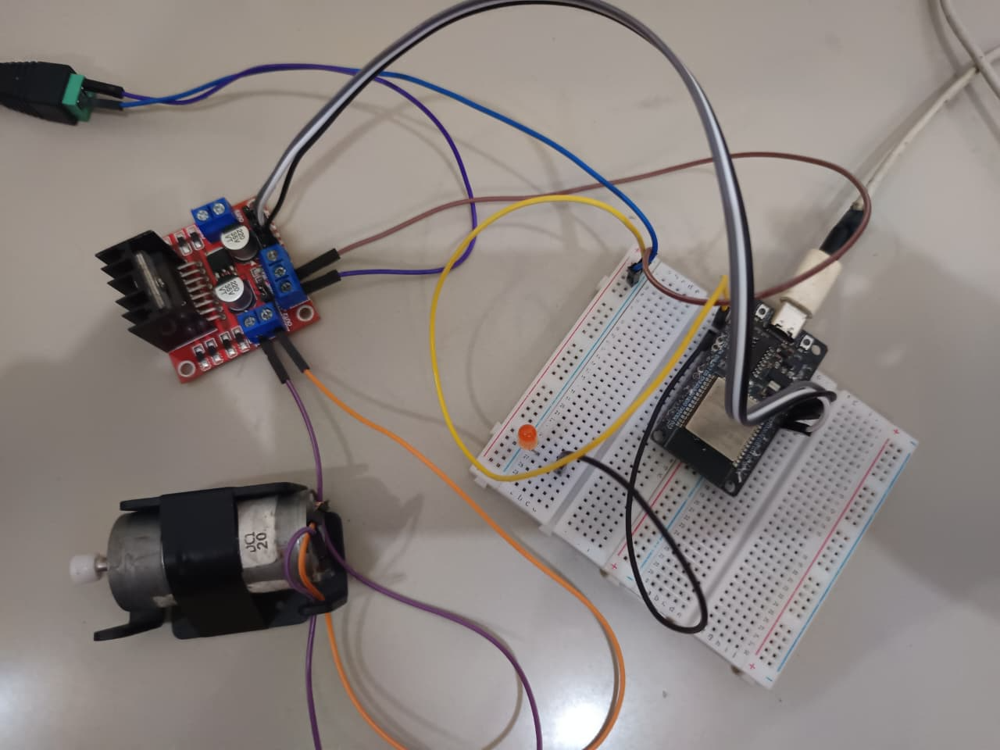
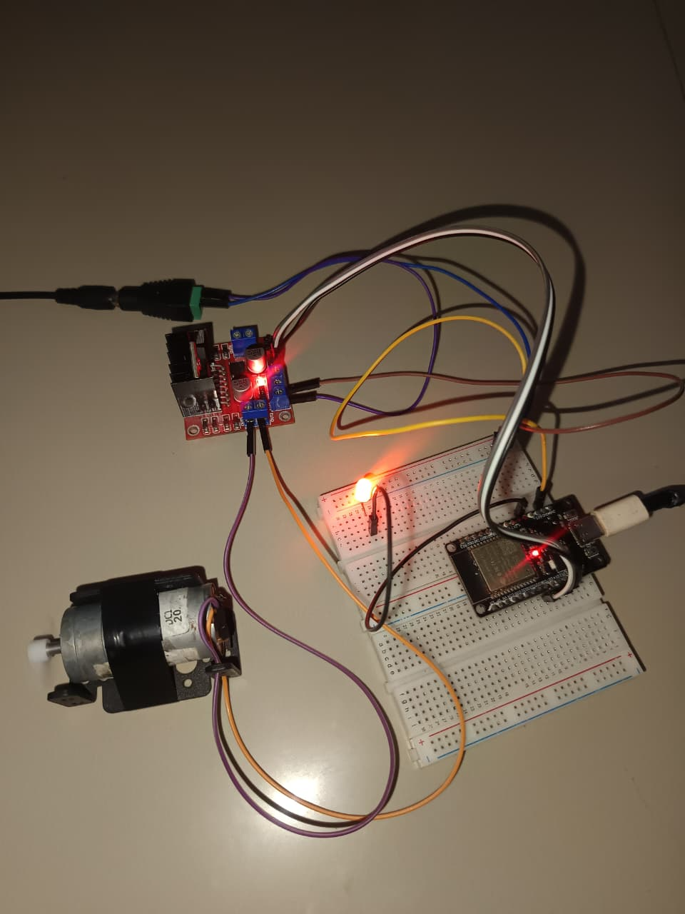
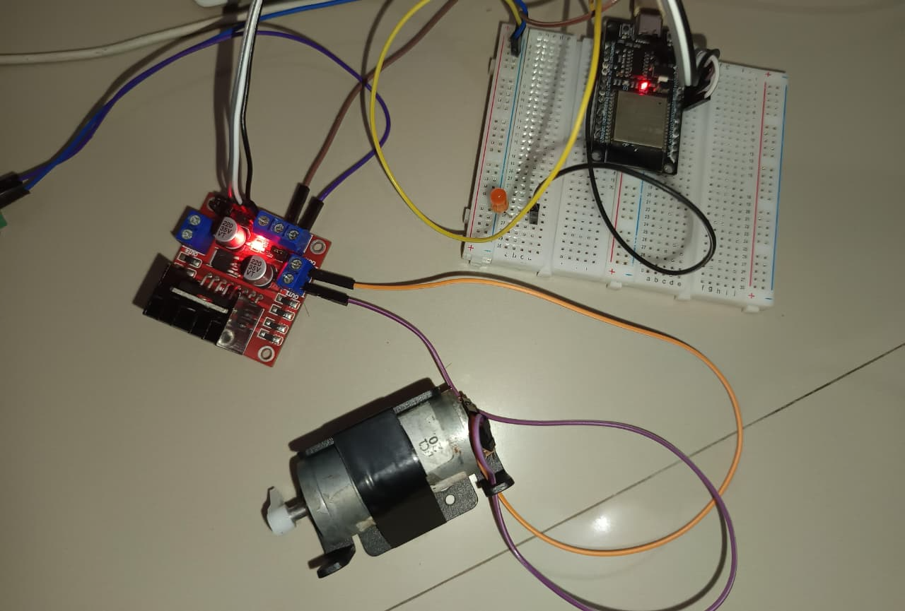

# Laporan Riset Modul 1: Pemrograman Basic & Komunikasi Serial

| Data Diri       | Keterangan    |
| :-------------- | :------------ |
| **Mata Kuliah** | Robotika A081 |
| **Nama**        | Restu Alam    |
| **NPM**         | 24081010352   |

---

## 1. Tujuan Eksperimen

1. Memahami dasar antarmuka (interfacing) Mikrokontroler ESP32 dengan Aktuator (Motor DC) dan LED.
2. Memahami konsep komunikasi dua arah antara komputer dan mikrokontroler menggunakan antarmuka **Serial Monitor**.
3. Menerapkan logika pengkondisian (`if-else`) untuk membaca input _String_ dari pengguna dan mengubahnya menjadi instruksi perangkat keras (ON/OFF).

## 2. Alat dan Komponen (Kit iMCLab)

- 1x Mikrokontroler ESP32 (DevKit)
- 1x Motor Driver L298N
- 1x Motor DC (Aktuator) & 1x LED Eksternal
- Kabel Jumper & Breadboard
- Kabel USB (sebagai jalur daya dan komunikasi serial)

## 3. Skema Rangkaian (Wiring)

| Komponen L298N / LED | Pin ESP32 (GPIO) | Fungsi                        |
| :------------------- | :--------------- | :---------------------------- |
| IN1                  | D26              | Sinyal logika putaran         |
| IN2                  | D27              | Sinyal logika putaran         |
| ENA                  | D14              | Sinyal daya/kecepatan (PWM)   |
| GND                  | GND              | Common Ground ESP32 dan L298N |
| Anoda LED (+)        | D4               | Indikator visual sistem ON    |



_(Keterangan: Dokumentasi perakitan perangkat keras Kit iMCLab untuk Modul 1. Memperlihatkan jalur data dari ESP32 ke driver L298N serta sistem Common Ground)_

## 4. Source Code (Arduino IDE)

Program ini menggunakan fungsi `Serial.readStringUntil('\n')` untuk menangkap input teks dari pengguna melalui komputer, lalu membandingkannya menggunakan blok `if-else` untuk menyalakan atau mematikan motor.

```cpp
const int led = 4;
const int in1 = 26;
const int in2 = 27;
const int ena = 14;

void setup() {
  Serial.begin(115200);

  pinMode(led, OUTPUT);
  pinMode(in1, OUTPUT);
  pinMode(in2, OUTPUT);
  pinMode(ena, OUTPUT);

  digitalWrite(in1, LOW);
  digitalWrite(in2, LOW);
  analogWrite(ena, 0);

  Serial.println("\n--- Sistem Siap ---");
  Serial.println("Ketik 'ON' untuk menyalakan motor, atau 'OFF' untuk mematikan.");
}

void loop() {
  if (Serial.available() > 0) {

    String perintah = Serial.readStringUntil('\n');
    perintah.trim();

    if (perintah == "ON" || perintah == "on") {
      Serial.println("Status: Motor MENYALA");
      digitalWrite(led, HIGH);
      digitalWrite(in1, HIGH);
      digitalWrite(in2, LOW);
      analogWrite(ena, 255);
    }
    else if (perintah == "OFF" || perintah == "off") {
      Serial.println("Status: Motor BERHENTI");
      digitalWrite(led, LOW);
      digitalWrite(in1, LOW);
      digitalWrite(in2, LOW);
      analogWrite(ena, 0);
    }
    else {
      Serial.println("Perintah tidak dikenal. Ketik 'ON' atau 'OFF'.");
    }
  }
}
```

## 5. Dokumentasi dan Analisis Riset

### 5.1. Analisis Komunikasi Serial dan Parsing String

Pada eksperimen ini, operasi ON/OFF tidak diatur menggunakan penundaan waktu otomatis (delay), melainkan dikontrol secara interaktif berbasis kueri. Fungsi Serial.available() bertindak sebagai pendengar (listener) yang memantau apakah ada paket data yang masuk melalui port USB.

Penggunaan fungsi perintah.trim() pada kode merupakan langkah troubleshooting perangkat lunak (software) yang krusial. Fungsi ini membersihkan spasi ekstra atau karakter tersembunyi seperti carriage return (\r) yang sering terikut saat menekan tombol Enter di Serial Monitor, sehingga logika komparasi String tidak mengalami kegagalan.

### 5.2. Pengujian Kondisi Aktif (Perintah "ON")


(Keterangan: Respons ESP32 pada Serial Monitor saat menerima instruksi ON)


(Keterangan: Motor DC berputar di kecepatan maksimal dan LED eksternal menyala sebagai indikator visual)

Pembahasan Hardware: Ketika pengguna mengetikkan "ON", mikrokontroler segera mengeksekusi perintah pemicuan pin GPIO ke status HIGH. Fungsi analogWrite(ena, 255) digunakan untuk membuka gerbang PWM secara penuh (100% Duty Cycle pada skala 8-bit), memberikan distribusi daya tegangan maksimal kepada aktuator melalui driver L298N.

### 5.3. Pengujian Kondisi Berhenti (Perintah "OFF")


(Keterangan: Putaran aktuator terhenti total dan LED indikator padam)

Pembahasan Hardware: Saat antarmuka logika menerima instruksi "OFF", sistem mengeksekusi pemutusan daya. Semua sinyal kontrol relai arah (in1 dan in2) dikembalikan ke status LOW, serta nilai pin ENA diturunkan ke 0 untuk memastikan putaran motor terhenti tanpa adanya sisa tegangan (residual voltage) pada terminal L298N.

## 6. Kesimpulan

Mikrokontroler mampu bertindak sebagai unit pemroses sentral yang membaca instruksi dari dunia luar (melalui port Serial USB) dan menerjemahkannya ke dalam aksi fisik (aktuasi motor). Logika pemrograman string parsing yang akurat dan bersih (melalui implementasi .trim()) sangat dibutuhkan agar mikrokontroler tidak salah dalam menafsirkan input pengguna sebelum mendistribusikan sinyal tegangan ke driver L298N.
