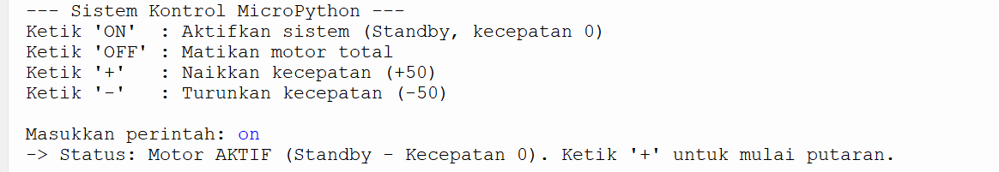
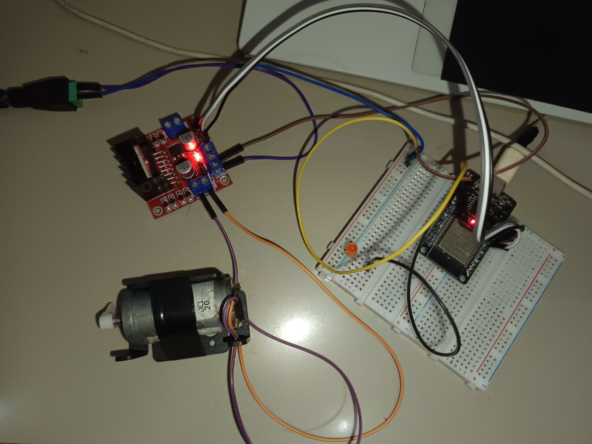
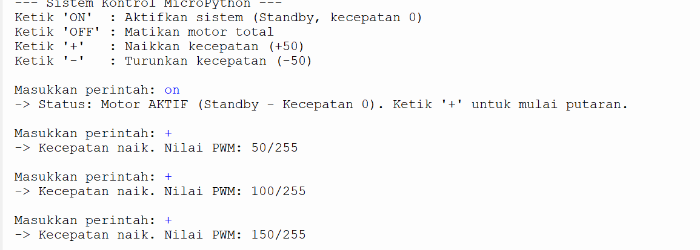

# Laporan Riset Modul 2: Pemrograman Robotika Menggunakan Python (MicroPython)

| Data Diri | Keterangan |
| :--- | :--- |
| **Mata Kuliah** | Robotika A081 |
| **Nama** | Restu Alam |
| **NPM** | 24081010352 |

---

## 1. Tujuan Eksperimen
1. Memahami proses transisi *firmware* mikrokontroler dari C++ (Arduino) ke interpreter MicroPython.
2. Menggunakan fitur antarmuka interaktif (REPL) pada Thonny IDE sebagai pengganti Serial Monitor.
3. Menerapkan status *Standby* pada aktuator, di mana sistem berstatus aktif namun menahan kecepatan di angka nol hingga ada instruksi *incremental* (+50 / -50).
4. Menerapkan pengkondisian *clamping* untuk batas atas (255) dan batas bawah (0) nilai PWM.
5. Membuktikan paralelisme PWM ESP32 dengan menyinkronkan tiga komponen sekaligus (Aktuator L298N, LED Internal, dan LED Eksternal) menggunakan satu variabel kontrol.

## 2. Alat dan Perangkat Lunak
* 1x Mikrokontroler ESP32 (DevKit) - *Memanfaatkan LED internal biru*
* 1x Motor Driver L298N & Motor DC
* 1x LED Eksternal & Resistor
* Kabel Data USB (jalur daya dan komunikasi serial REPL)
* Perangkat Lunak: **Thonny IDE** 
* *Firmware*: MicroPython ESP32 (.bin)

## 3. Skema Rangkaian (Wiring)
Pengkabelan fisik pada modul ini memanfaatkan dua jenis indikator visual (internal dan eksternal) secara bersamaan untuk memantau sinyal PWM:

| Komponen | Pin ESP32 | Keterangan Fungsi |
| :--- | :--- | :--- |
| **IN1** (L298N) | D26 | Sinyal digital (Arah Maju) |
| **IN2** (L298N) | D27 | Sinyal digital (Arah Mundur) |
| **ENA** (L298N) | D14 | Jalur PWM utama (Kecepatan Motor) |
| **LED Eksternal** | D4  | Jalur PWM sekunder 1 (Indikator Kecerahan Eksternal) |
| **Internal LED**  | D2  | Jalur PWM sekunder 2 (Indikator Kecerahan *On-board*) |

## 4. Source Code (Thonny IDE)
Program dirancang menggunakan manajemen status (State Management) variabel `current_pwm`. Persamaan matematis digunakan untuk menyelaraskan parameter input pengguna (0-255) dengan parameter arsitektur PWM MicroPython (0-1023).

```python
from machine import Pin, PWM

in1 = Pin(26, Pin.OUT)
in2 = Pin(27, Pin.OUT)

ena = PWM(Pin(14), freq=1000)
led = PWM(Pin(2), freq=1000)

in1.value(0)
in2.value(0)
ena.duty(0)
led.duty(0)

current_pwm = 0

print("--- Sistem Kontrol MicroPython ---")
print("Ketik 'ON'  : Aktifkan sistem (Standby, kecepatan 0)")
print("Ketik 'OFF' : Matikan motor total")
print("Ketik '+'   : Naikkan kecepatan (+50)")
print("Ketik '-'   : Turunkan kecepatan (-50)\n")

while True:
    perintah = input("Masukkan perintah: ").upper()
    
    if perintah == "ON":
        in1.value(1)
        in2.value(0)
        current_pwm = 0
        ena.duty(0) 
        led.duty(0)
        print("-> Status: Motor AKTIF (Standby - Kecepatan 0). Ketik '+' untuk mulai putaran.\n")
        
    elif perintah == "OFF":
        in1.value(0)
        in2.value(0)
        current_pwm = 0
        ena.duty(0)
        led.duty(0)
        print("-> Status: Motor BERHENTI TOTAL\n")
        
    elif perintah == "+":
        in1.value(1)
        in2.value(0)
        current_pwm += 50
        if current_pwm > 255:
            current_pwm = 255
            
        duty_10bit = int((current_pwm / 255) * 1023)
        ena.duty(duty_10bit)
        led.duty(duty_10bit)
        print(f"-> Kecepatan naik. Nilai PWM: {current_pwm}/255\n")
        
    elif perintah == "-":
        in1.value(1)
        in2.value(0)
        current_pwm -= 50
        if current_pwm < 0:    
            current_pwm = 0
            
        duty_10bit = int((current_pwm / 255) * 1023)
        ena.duty(duty_10bit)
        led.duty(duty_10bit)
        print(f"-> Kecepatan turun. Nilai PWM: {current_pwm}/255\n")
        
    else:
        print("-> Error: Perintah tidak dikenali!\n")
```

## 5. Dokumentasi dan Analisis Riset
### 5.1. Analisis Fase "Standby" (Kecepatan 0)
Ketika program dijalankan dan menerima instruksi ON, sistem masuk ke perlindungan Standby.


(Keterangan: Respons Shell Thonny saat menerima instruksi 'ON')


(Keterangan: Rangkaian fisik saat mode Standby. Aktuator siap bekerja, namun kedua LED dan motor belum menerima siklus daya)

Pembahasan Hardware: Secara logika, ESP32 telah mengunci gerbang arah relai (in1.value(1)). Namun, karena variabel duty cycle ditahan di angka 0, tidak ada arus yang mengalir. Hal ini sangat berguna untuk memastikan stabilitas mekanis sebelum lonjakan daya (PWM) diberikan.

5.2. Analisis Kontrol Inkremental (-/+) dan Paralelisme Ganda
Pengujian dinamika arus PWM dibuktikan dengan memberikan perintah variasi naik (+) dan turun (-).

Kondisi Kecepatan Rendah (Perintah '-'):

(Keterangan: Penurunan variabel memori status saat perintah '-' dieksekusi)


(Keterangan: Motor berputar lambat. LED Internal (biru) dan LED Eksternal menyala redup secara sinkron)

Kondisi Kecepatan Tinggi (Perintah '+'):

(Keterangan: Kenaikan variabel memori saat perintah '+' diinput, menguji batas limitasi / clamping atas)


(Keterangan: Motor berputar sangat kencang (100% Duty Cycle), diiringi pendaran cahaya maksimal pada kedua LED)

Pembahasan Konversi & Paralelisme:
Terdapat perbedaan arsitektur bawaan lingkungan Arduino C++ (8-bit) dengan MicroPython (10-bit). Untuk menjaga antarmuka pengguna agar tetap berada di rentang 0-255, perangkat lunak melakukan konversi melalui rumus int((current_pwm / 255) * 1023). Hasil angka 10-bit inilah yang didistribusikan secara identik ke Pin 14 (Motor), Pin 2 (LED Internal), dan Pin 4 (LED Eksternal). Keberhasilan sinkronisasi ini membuktikan bahwa ESP32 sanggup mengeksekusi kendali tegangan paralel tanpa terjadinya latensi atau bottleneck instruksi.

## 6. Kesimpulan
Bahasa MicroPython memberikan fleksibilitas manipulasi logika variabel (seperti konversi 8-bit ke 10-bit dan clamping memori) yang dapat dipantau langsung melalui antarmuka REPL. Penggabungan hardware (motor DC bersama dua LED indikator independen) membuktikan bahwa sistem berbasis PWM dapat mendistribusikan variabel State tunggal ke dalam berbagai bentuk keluaran analog secara stabil, presisi, dan aman berkat implementasi mode Standby.