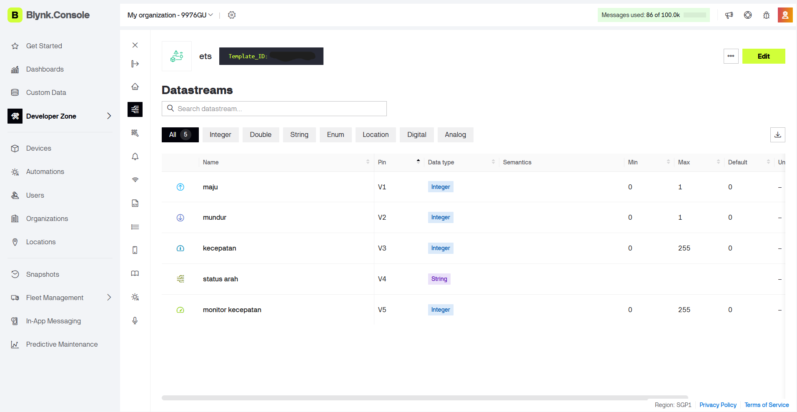
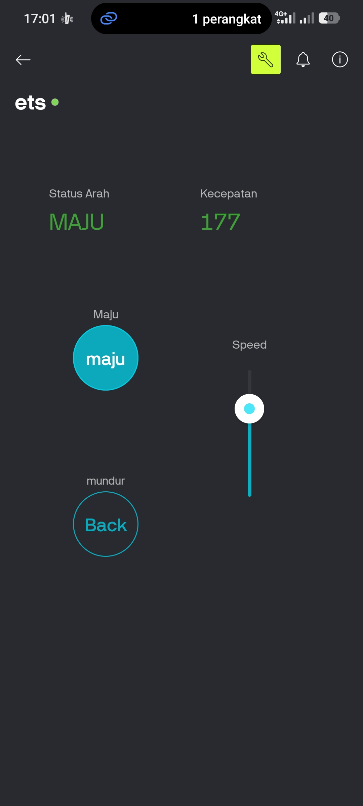
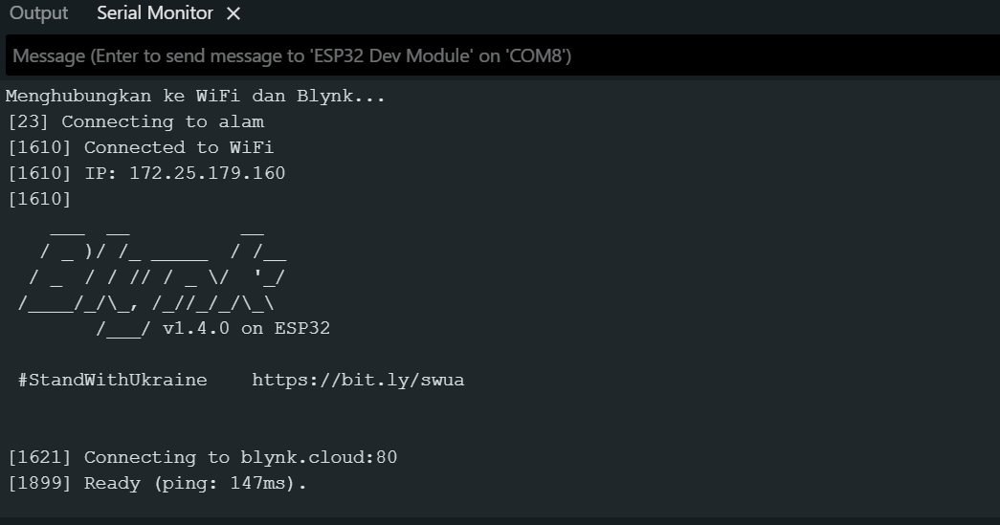
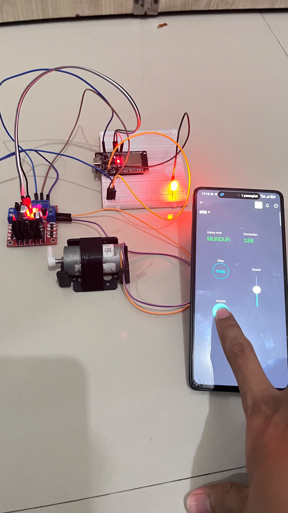

# Laporan Riset Modul 3: iMCLab Berbasis Blynk

| Data Diri       | Keterangan    |
| :-------------- | :------------ |
| **Mata Kuliah** | Robotika A081 |
| **Nama**        | Restu Alam    |
| **NPM**         | 24081010352   |

---

## 1. Tujuan Eksperimen
1. Mengintegrasikan mikrokontroler ESP32 dengan *platform server Cloud* IoT (Blynk).
2. Menerapkan kendali aktuator nirkabel (arah putaran dan PWM kecepatan) melalui *smartphone*.
3. Memahami konsep komunikasi dua arah (*Two-Way Communication*) menggunakan *Virtual Pin* untuk sinkronisasi status perangkat keras dan antarmuka lunak.
4. Menerapkan arsitektur pemrograman berbasis *event-driven* (interupsi asinkron) untuk menggantikan sistem *polling* konvensional.

## 2. Alat dan Perangkat Lunak
- 1x Mikrokontroler ESP32 (DevKit)
- 1x Motor Driver L298N & Motor DC
- 1x LED Eksternal
- Kabel Jumper & Powerbank (Sumber daya *wireless*)
- Perangkat Lunak: **Arduino IDE** (Lingkungan C++) & **Blynk IoT App** (Web/Mobile)
- *Library*: `BlynkSimpleEsp32.h`
- Koneksi Internet (Jaringan WiFi `alam`)

## 3. Skema Rangkaian & Pemetaan Pin Virtual
Antarmuka pengguna didistribusikan ke *Cloud* menggunakan *Virtual Pin*, sementara *hardware* murni bertindak sebagai pengeksekusi daya.

**A. Skema Hardware (ESP32 ke Komponen):**
| Komponen | Pin ESP32 | Keterangan Fungsi |
| :--- | :--- | :--- |
| **IN1** | D26 | Sinyal logika relai putaran MAJU |
| **IN2** | D27 | Sinyal logika relai putaran MUNDUR |
| **ENA** | D14 | Sinyal daya/kecepatan (PWM) |
| **LED** | D4  | Indikator operasional sistem |

**B. Skema Software (Blynk Datastream):**
| Widget Blynk | Virtual Pin | Tipe Data | Fungsi pada Sistem |
| :--- | :--- | :--- | :--- |
| **Button 1** | V1 | Integer | Saklar pemicu arah MAJU (1/0) |
| **Button 2** | V2 | Integer | Saklar pemicu arah MUNDUR (1/0) |
| **Slider** | V3 | Integer | Pengatur nilai kecepatan (Rentang: 0-255) |
| **Value Display** | V4 | **String** | Penampil teks status operasional ("MAJU", "MUNDUR", "BERHENTI") |
| **Gauge / Display**| V5 | Integer | Penampil angka *Duty Cycle* (PWM) aktual |

## 4. Source Code (Arduino IDE)
Program dirancang dengan membuat fungsi khusus `updateBlynkDisplay()` untuk mempermudah sinkronisasi variabel global ke antarmuka aplikasi.

```cpp
#define BLYNK_PRINT Serial
#define BLYNK_TEMPLATE_ID "TMPL6u4t3xiu1"
#define BLYNK_TEMPLATE_NAME "ets"
#define BLYNK_AUTH_TOKEN "lkGBVE7mpjUivZKLRAMQC1MmiPxUPA4K"

#include <WiFi.h>
#include <WiFiClient.h>
#include <BlynkSimpleEsp32.h>

char ssid[] = "alam";      
char pass[] = "alam1234";  

const int led = 4;
const int in1 = 26;
const int in2 = 27;
const int ena = 14;

String currentDirection = "BERHENTI";
int currentSpeed = 0;

void updateBlynkDisplay() {
  Blynk.virtualWrite(V4, currentDirection); 
  Blynk.virtualWrite(V5, currentSpeed);    
}

void setup() {
  Serial.begin(115200);

  pinMode(led, OUTPUT);
  pinMode(in1, OUTPUT);
  pinMode(in2, OUTPUT);
  pinMode(ena, OUTPUT);

  digitalWrite(in1, LOW);
  digitalWrite(in2, LOW);
  analogWrite(ena, 0);

  Serial.println("Menghubungkan ke WiFi dan Blynk...");
  Blynk.begin(BLYNK_AUTH_TOKEN, ssid, pass);

  updateBlynkDisplay(); 
}

void loop() {
  Blynk.run();
}


BLYNK_WRITE(V1) {
  if (param.asInt() == 1) {
    currentDirection = "MAJU";
    digitalWrite(in1, HIGH);
    digitalWrite(in2, LOW);
    digitalWrite(led, HIGH);
  } else {
    currentDirection = "BERHENTI";
    digitalWrite(in1, LOW);
    digitalWrite(in2, LOW);
    digitalWrite(led, LOW);
  }
  updateBlynkDisplay();
}

BLYNK_WRITE(V2) {
  if (param.asInt() == 1) {
    currentDirection = "MUNDUR";
    digitalWrite(in1, LOW);
    digitalWrite(in2, HIGH);
    digitalWrite(led, HIGH);
  } else {
    currentDirection = "BERHENTI";
    digitalWrite(in1, LOW);
    digitalWrite(in2, LOW);
    digitalWrite(led, LOW);
  }
  updateBlynkDisplay();
}

BLYNK_WRITE(V3) {
  currentSpeed = param.asInt(); 
  analogWrite(ena, currentSpeed); 
  updateBlynkDisplay(); 
}
```

## 5. Dokumentasi dan Analisis Riset
### 5.1. Analisis Konfigurasi Server dan Virtual Pin (Laptop)
Langkah pertama dalam arsitektur Blynk adalah membuat jembatan komunikasi (Datastream) di sisi server sebelum dapat digunakan oleh antarmuka aplikasi.



(Keterangan: Konfigurasi tipe data pada Datastream Blynk di Web Dashboard. Memperlihatkan alokasi pin V1 hingga V5)

Pembahasan: Berbeda dengan pin GPIO fisik, Virtual Pin adalah abstraksi saluran memori di dalam server Blynk. Pengaturan tipe data (Data Type) di server sangat krusial. Pada Pin V4, Datastream disetel ke mode String, yang memungkinkan ESP32 mengirimkan paket teks ("MAJU", "MUNDUR", dll) tanpa perlu memecahnya ke dalam format heksadesimal (byte array) secara manual. Hal ini memperlihatkan kemampuan encapsulation data dari library Blynk yang sangat memudahkan pengembang.

### 5.2. Analisis Telemetri dan Komunikasi Dua Arah (Smartphone)
Pengendalian Internet of Things yang baik tidak hanya bersifat memerintah (satu arah), melainkan harus memiliki umpan balik status aktuator secara aktual (Telemetri).



(Keterangan: Tampilan antarmuka Blynk App di smartphone saat mengirimkan perintah kendali)

Pembahasan: Fungsi updateBlynkDisplay() di dalam kode C++ memainkan peran telemetri ini. Saat pengguna berinteraksi dengan tombol UI, nilai masuk ke ESP32. ESP32 kemudian mengubah variabel global currentDirection dan currentSpeed, dan segera memantulkan (mirroring) status terbaru perangkat keras kembali ke server (Cloud) menggunakan Blynk.virtualWrite(). Arsitektur dua arah ini memastikan layar HP selalu menampilkan kondisi arus listrik sebenarnya yang sedang dialami oleh L298N.

### 5.3. Pengujian Asinkronisitas TCP/IP dan Perangkat Keras
Uji coba sistem dilakukan dengan mencabut kabel data USB dari komputer, dan menyuplai ESP32 menggunakan Powerbank independen.



(Keterangan: Log Serial Monitor menunjukkan keberhasilan negosiasi alamat IP lokal dan proses handshaking ke server Blynk)



(Keterangan: Sistem aktuator berjalan murni secara nirkabel (wireless) memproses instruksi dari cloud, suplai daya melalui Powerbank)

Pembahasan: Perpindahan dari Modul 1 (Serial) ke Modul 3 (Blynk) mengubah arsitektur baca-tulis mikrokontroler. Fungsi utama void loop() kini hanya berisi satu baris: Blynk.run(). Baris ini bertugas secara kontinu memelihara ping/pong koneksi TCP/IP agar tidak time-out.
Sementara itu, instruksi aktuator diletakkan pada BLYNK_WRITE(). Fungsi ini bertindak sebagai asynchronous callback (interupsi perangkat lunak). ESP32 tidak membuang siklus clock untuk terus-menerus bertanya "apakah ada data masuk?" seperti pada pemrograman Serial, melainkan hanya akan bereaksi ketika ada muatan data (payload) yang disuntikkan dari server Blynk, menjadikannya sangat hemat daya dan bebas latensi tunda (delay).

## 6. Kesimpulan
Integrasi sistem robotika dasar dengan arsitektur Blynk membuktikan keandalan mikrokontroler ESP32 dalam menangani tumpukan (stack) protokol jaringan nirkabel secara efisien. Penggunaan fungsi pembaruan Virtual Pin (V4 dan V5) dan mekanisme event-driven (BLYNK_WRITE) berhasil menciptakan sistem telemetri kontrol jarak jauh yang responsif, stabil, dan minim penggunaan sumber daya komputasi.