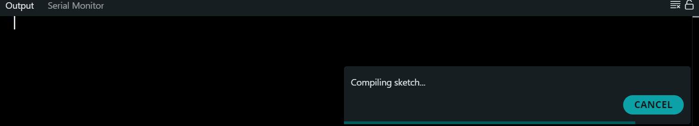
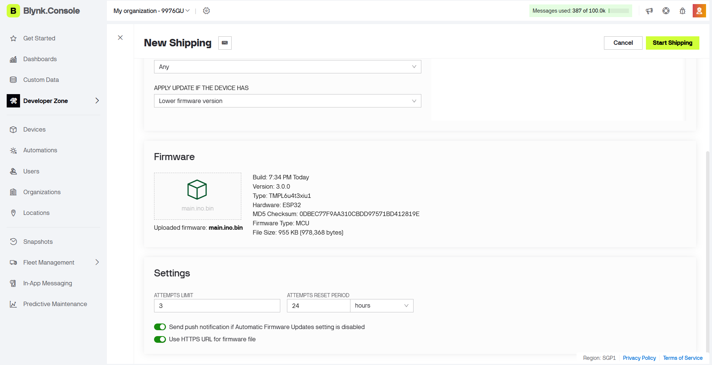
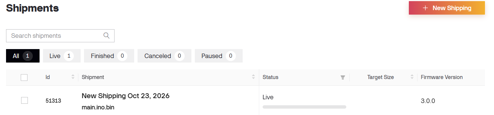
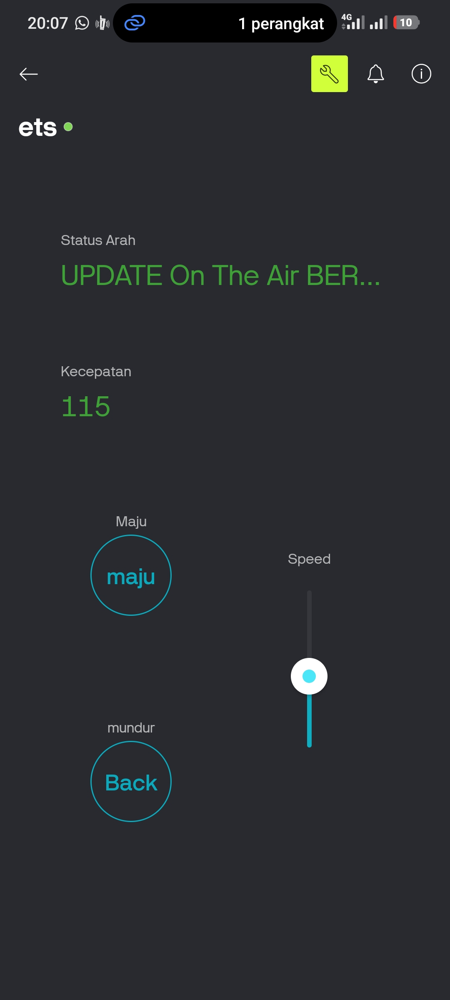
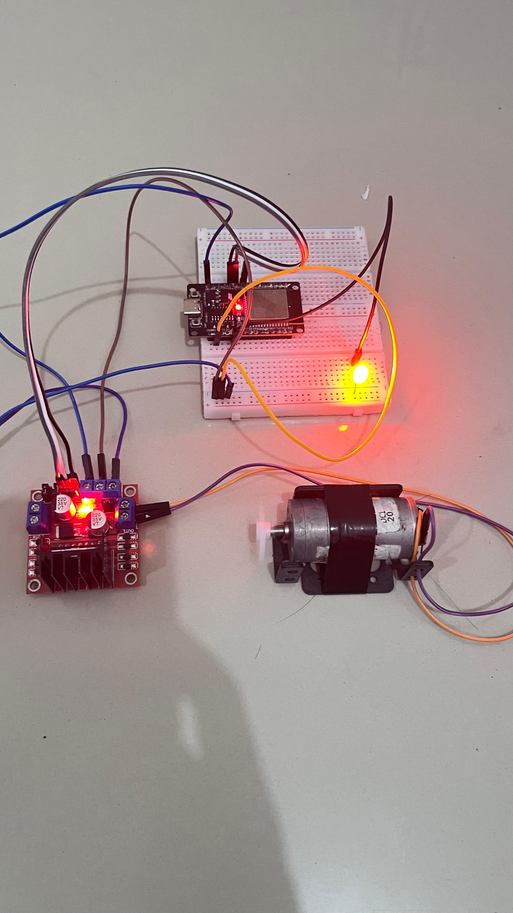

# Laporan Riset Modul 4: Pembaruan Perangkat Lunak Nirkabel (OTA) Menggunakan Blynk.Air

| Data Diri       | Keterangan    |
| :-------------- | :------------ |
| **Mata Kuliah** | Robotika A081 |
| **Nama**        | Restu Alam    |
| **NPM**         | 24081010352   |

---

## 1. Tujuan Eksperimen
1. Memahami konsep dasar pembaruan *firmware* jarak jauh (Over-The-Air / OTA).
2. Memanfaatkan fitur **Blynk.Air** untuk melakukan *flashing* perangkat lunak pada ESP32 secara nirkabel (tanpa koneksi kabel USB ke komputer).
3. Menerapkan manajemen versi perangkat lunak (*Firmware Versioning*) menggunakan makro pra-pemrosesan C++.
4. Menghindari keausan port fisik mikrokontroler dan mempercepat proses iterasi pengembangan pada robot nirkabel.

## 2. Alat dan Perangkat Lunak
- 1x Mikrokontroler ESP32 (DevKit)
- 1x Motor Driver L298N & Motor DC
- 1x LED Eksternal
- Sumber Daya Independen (Powerbank atau *Step-down* 5V dari L298N)
- Perangkat Lunak: **Arduino IDE** (Lingkungan C++) & **Blynk Web Dashboard**
- *Library*: `BlynkSimpleEsp32.h`

## 3. Skema Rangkaian & Pemetaan Pin Virtual
Skema perangkat keras pada Modul 4 ini **100% identik** dengan Modul 3. Keunggulan utama OTA adalah kita tidak perlu lagi membongkar pasang atau mematikan perangkat keras untuk menyuntikkan kode baru.

## 4. Source Code (Arduino IDE)
Kode ini adalah pengembangan dari Modul 3. Terdapat dua modifikasi krusial: penambahan definisi `BLYNK_FIRMWARE_VERSION` untuk dibaca oleh server OTA, dan pengubahan teks status awal menjadi `"UPDATE V2 SUKSES"` sebagai indikator visual bahwa proses *flashing* nirkabel telah berhasil.

```cpp
#define BLYNK_PRINT Serial
#define BLYNK_TEMPLATE_ID "TMPL6u4t3xiu1"
#define BLYNK_TEMPLATE_NAME "ets"
#define BLYNK_AUTH_TOKEN "lkGBVE7mpjUivZKLRAMQC1MmiPxUPA4K"

#define BLYNK_FIRMWARE_VERSION "2.0.0"

#include <WiFi.h>
#include <WiFiClient.h>
#include <BlynkSimpleEsp32.h>

char ssid[] = "alam";      
char pass[] = "alam1234";  

const int led = 4;
const int in1 = 26;
const int in2 = 27;
const int ena = 14;

String currentDirection = "UPDATE V2 SUKSES";
int currentSpeed = 0;

void updateBlynkDisplay() {
  Blynk.virtualWrite(V4, currentDirection); 
  Blynk.virtualWrite(V5, currentSpeed);     
}

void setup() {
  Serial.begin(115200);

  pinMode(led, OUTPUT);
  pinMode(in1, OUTPUT);
  pinMode(in2, OUTPUT);
  pinMode(ena, OUTPUT);

  digitalWrite(in1, LOW);
  digitalWrite(in2, LOW);
  analogWrite(ena, 0);

  Serial.println("Menghubungkan ke WiFi dan Blynk...");
  Blynk.begin(BLYNK_AUTH_TOKEN, ssid, pass);

  updateBlynkDisplay(); 
}

void loop() {
  Blynk.run();
}

BLYNK_WRITE(V1) {
  if (param.asInt() == 1) {
    currentDirection = "MAJU";
    digitalWrite(in1, HIGH);
    digitalWrite(in2, LOW);
    digitalWrite(led, HIGH);
  } else {
    currentDirection = "BERHENTI";
    digitalWrite(in1, LOW);
    digitalWrite(in2, LOW);
    digitalWrite(led, LOW);
  }
  updateBlynkDisplay();
}

BLYNK_WRITE(V2) {
  if (param.asInt() == 1) {
    currentDirection = "MUNDUR";
    digitalWrite(in1, LOW);
    digitalWrite(in2, HIGH);
    digitalWrite(led, HIGH);
  } else {
    currentDirection = "BERHENTI";
    digitalWrite(in1, LOW);
    digitalWrite(in2, LOW);
    digitalWrite(led, LOW);
  }
  updateBlynkDisplay(); 
}

BLYNK_WRITE(V3) {
  currentSpeed = param.asInt(); 
  analogWrite(ena, currentSpeed); 
  updateBlynkDisplay();
}
```

## 5. Dokumentasi dan Analisis Riset
### 5.1. Analisis Kompilasi Perangkat Lunak (Binary Export)
Proses OTA membutuhkan file matang (compiled binary) berformat .bin alih-alih bahasa C++ murni.



(Keterangan: Proses Export Compiled Binary pada antarmuka Arduino IDE)

Pembahasan: Di Arduino IDE, kode tidak langsung diunggah, melainkan dikonversi menggunakan fitur Sketch > Export Compiled Binary. Proses ini merakit kode C++ beserta seluruh pustaka (library) BlynkSimpleEsp32.h dan WiFi.h menjadi satu file mesin (hex/bin) yang siap ditransmisikan. Pendefinisian makro #define BLYNK_FIRMWARE_VERSION "2.0.0" sangat penting karena server Blynk.Air menggunakan metadata ini untuk memverifikasi apakah paket yang dikirim benar-benar versi terbaru atau file yang sama.

### 5.2. Analisis Distribusi Nirkabel melalui Blynk.Air
Pengiriman file .bin dilakukan melalui perantara server Cloud, bukan transmisi langsung antar perangkat.



(Keterangan: Antarmuka Blynk.Air Shipment pada Web Dashboard saat mengunggah file .bin dan memulai proses pengiriman ke ESP32)



(Keterangan: Antarmuka Proses Shipment pada Web Dashboard Blynk)

Pembahasan: Setelah file diunggah ke Blynk.Air dan pengiriman ( Shipment ) dimulai, server memberikan notifikasi kepada mikrokontroler target. Mikrokontroler kemudian menghentikan aktivitas utamanya sejenak, mengunduh paket data ke dalam partisi OTA di memori Flash internalnya, memverifikasi integritas file, dan melakukan restart secara mandiri. Arsitektur ini sangat aman (failsafe); jika koneksi WiFi terputus di tengah proses unduhan, ESP32 akan membatalkan pembaruan dan tetap menggunakan kode versi lama.

### 5.3. Pengujian Hasil Pembaruan (Verification)
Bukti keberhasilan ditandai dengan perubahan logika operasi sesaat setelah alat me- restart dirinya sendiri.



(Keterangan: Tampilan antarmuka pada Blynk App di HP yang otomatis berubah menjadi "UPDATE ON THE AIR BERHASIL" setelah alat selesai melakukan restart nirkabel)



(Keterangan: Alat berjalan dengan logika baru tanpa ada kabel USB yang menghubungkannya ke komputer pengembangan, melainkan menggunakan daya independen dari baterai/Powerbank)

Pembahasan: Perpindahan variabel currentDirection menjadi "UPDATE V2 SUKSES" pada layar smartphone sesaat setelah sistem menyala adalah bukti empiris bahwa memori Flash telah berhasil ditimpa melalui WiFi. Penerapan teknologi OTA sangat krusial dalam robotika bergerak (mobile robotics) karena teknisi dapat menambal bug atau mengubah algoritma kelistrikan tanpa harus mendekati, menghentikan, atau mencolokkan kabel ke motherboard robot secara fisik.

## 6. Kesimpulan
Pemrograman Over-The-Air (OTA) menyempurnakan ekosistem Internet of Things dengan menghilangkan batasan manipulasi perangkat keras fisik. Melalui fitur Blynk.Air dan pembagian partisi memori pada ESP32, siklus perbaikan perangkat lunak (software iteration) dapat dilakukan secara terpusat, aman, dan sangat efisien meskipun aktuator/robot sedang berada di lokasi yang jauh dari stasiun pemrograman.